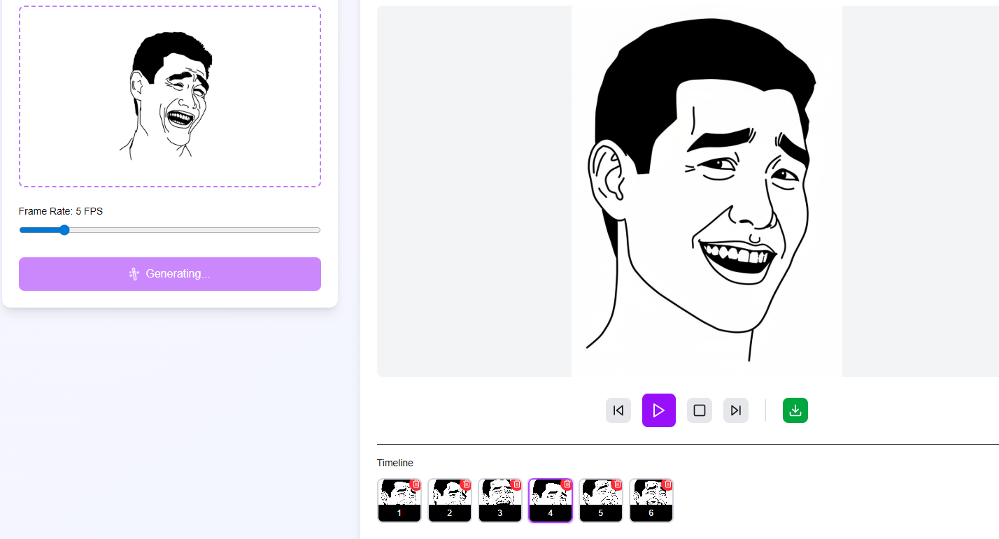
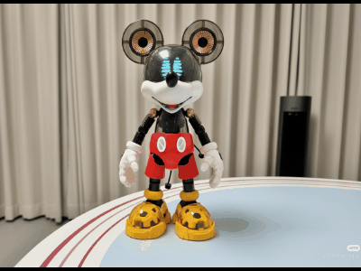

# NanoMotion

> 一张图片，生成一段定格动画。

NanoMotion 是一个基于 Next.js 15 的 Web 应用：上传一张图片，自动通过 [apiz.ai](https://api.apiz.ai)（`fal-ai/nano-banana-2`）并行生成 12 帧定格动画。在浏览器内即可预览、调速、拖拽重排、并一键导出 GIF——全程无需后端二次处理。

## 特性

- **一图生成 12 帧** — 内置 6 段基础姿势 + 6 段自动变体，循环展开为 12 帧序列。
- **并行生成** — 12 帧通过 `Promise.allSettled` 同时提交，单帧失败不会阻塞其他帧。
- **流式进度** — API 以 NDJSON-ish 事件流式回传每一帧结果，前端实时刷新。
- **浏览器内预览** — 帧率 1–30 FPS 可调，时间线支持拖拽排序和单帧删除。
- **一键导出 GIF** — 完全在浏览器端通过 [gifencoder](https://www.npmjs.com/package/gifencoder) 生成，无需往返服务端。
- **参考图床可替换** — apiz 要求 `image_urls` 必须是 HTTP/HTTPS URL，默认使用 [uguu.se](https://uguu.se)，可通过环境变量切换为自托管服务或 Vercel Blob。

## 快速开始

```bash
# 1. 安装依赖（推荐 pnpm）
pnpm install

# 2. 准备环境变量
cp .env.example .env
# 编辑 .env，填入你的 APIZ_API_KEY

# 3. 启动开发服务器
pnpm dev
```

打开 <http://localhost:3000>，拖入一张图片，点击 **Generate Animation** 即可。

## 环境变量

| 变量                          | 必填 | 默认值                       | 说明                                                                       |
| ----------------------------- | ---- | ---------------------------- | -------------------------------------------------------------------------- |
| `APIZ_API_KEY`                | ✅   | —                            | apiz.ai 的 API Key                                                         |
| `APIZ_API_BASE_URL`           | ❌   | `https://api.apiz.ai/api/v3` | API 基础地址                                                                |
| `APIZ_MODEL`                  | ❌   | `fal-ai/nano-banana-2`       | 图像生成模型                                                                |
| `APIZ_POLL_INTERVAL_MS`       | ❌   | `3000`                       | 任务状态轮询间隔（毫秒）                                                    |
| `APIZ_TIMEOUT_MS`             | ❌   | `300000`                     | 单个任务超时时间（毫秒）                                                    |
| `APIZ_REFERENCE_UPLOAD_URL`   | ❌   | `https://uguu.se/upload`     | 公网参考图床地址，用于满足 apiz 对 `image_urls` 的 HTTP/HTTPS 要求          |
| `APIZ_REFERENCE_UPLOAD_FIELD` | ❌   | `files[]`                    | 图床期望的 form-data 字段名                                                 |

> apiz 的 `image_urls` 字段只接受 HTTP/HTTPS URL，因此参考图必须先上传到公网图床。
> 如果不想使用 uguu.se，可以把 `APIZ_REFERENCE_UPLOAD_URL` 指向 Vercel Blob、S3 或自建端点。

## 架构

```
浏览器  (src/app/page.tsx)
  │
  │  POST /api/stop-motion  (multipart/form-data: image)
  ▼
Next.js API 路由  (src/app/api/stop-motion/route.ts)
  │
  │  1. 从 6 段姿势模板生成 12 帧序列            ← src/lib/poses.ts
  │
  │  2. 对每帧（并行执行）：
  │     a. 上传参考图到公网图床（uguu.se）       ← src/lib/ai.ts
  │     b. POST /tasks/create 提交生成任务
  │     c. 轮询 POST /tasks/query 直到完成
  │     d. 提取结果图片 URL
  │
  │  3. 以 `frame` / `frame_error` 事件流式回传给前端
  │
  ▼
浏览器：追加帧、渲染时间线、导出 GIF
```

### 关键设计

- **单 Provider AI 层**（[src/lib/ai.ts](file:///d:/ai-make-face-meme-main/src/lib/ai.ts)）— 一个 `generateImage(prompt, buffer, options)` 函数封装了 apiz 的异步任务 API。要接入其他 Provider，只需在此文件内扩展，路由层无需感知。
- **并行任务扇出** — 12 个 Promise 通过 `Promise.allSettled` 同时跑，得到统一的批次错误模型和可预测的延迟。
- **自定义分隔符的流式响应** — `\n---CHUNK_END---\n` 把 JSON 事件拼起来，前端用 `String.split` 即可解析，并且能正常穿越 Next.js 路由层。
- **零中间产物** — 参考图上传、生成图片、GIF 导出全部走内存或浏览器 Blob，不写盘。

## 项目结构

```
.
├── src/
│   ├── app/
│   │   ├── api/stop-motion/route.ts   # 流式生成端点
│   │   ├── layout.tsx                 # 根布局 + Geist 字体
│   │   ├── page.tsx                   # 上传、时间线、播放、导出
│   │   └── globals.css                # Tailwind 入口
│   └── lib/
│       ├── ai.ts                      # apiz.ai 客户端（提交、轮询、提取）
│       └── poses.ts                   # 姿势模板 + 帧 prompt 构造器
├── types/
│   └── gifencoder.d.ts                # 第三方类型补丁
├── .env.example
├── .gitignore
├── LICENSE                            # MIT
├── next.config.ts
├── eslint.config.mjs
├── tsconfig.json
└── package.json
```

## 常用命令

```bash
pnpm dev         # 启动开发服务器（Turbopack，http://localhost:3000）
pnpm build       # 生产构建
pnpm start       # 运行生产构建
pnpm lint        # ESLint
pnpm typecheck   # tsc --noEmit
```
## 实际效果






## 已知限制

- apiz 单帧约 30 秒（1K 分辨率、4:3，默认模型 32 积分/帧），12 帧并行通常 40–50 秒完成整批。
- 公网图床是外部依赖。如果 uguu.se 不可用或被屏蔽，将 `APIZ_REFERENCE_UPLOAD_URL` 切到自托管地址。
- GIF 导出最多取时间线前 12 帧；如需更长动画，修改 [src/app/page.tsx](file:///d:/ai-make-face-meme-main/src/app/page.tsx) 中的 `MAX_GIF_FRAMES`。

## 致谢

原始的定格动画流水线思路来自 [madhurjain/nanomotion](https://github.com/madhurjain/nanomotion)。当前实现是基于 apiz.ai 单一图像生成服务的全新重写。

图像生成由 [apiz.ai](https://api.apiz.ai) 提供支持。

## 许可证

MIT — 见 [LICENSE](file:///d:/ai-make-face-meme-main/LICENSE)。
